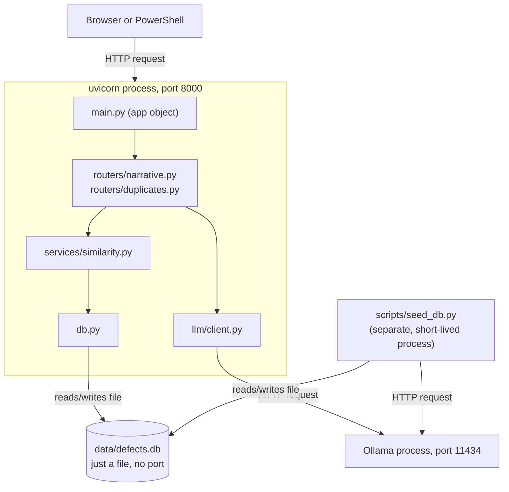

## Why this file exists

This captures the reasoning behind the local model choice for Jira Issue Architect, so the
decision can be revisited later without re-deriving it from scratch. It also documents the
difference between prompting, custom system prompts, and fine-tuning, since those three get
conflated easily when you're new to running models locally.

## Model options considered

An early search suggested Mistral 7B and Llama 2 13B as candidates. Both are worth
understanding, but Llama 2 is a 2023-era model and isn't a good baseline for a project
starting now.

| Model | Params | Context window | Status |
|---|---|---|---|
| Llama 2 13B | 13B | 4K tokens | Superseded, not recommended |
| Mistral 7B Instruct v0.3 | 7B | 32K tokens | Solid, viable alternative |
| Llama 3.1 8B Instruct | 8B | 128K tokens | Strong long-context alternative |
| Qwen2.5 7B Instruct | 7B | 128K tokens | Chosen for this project |
| Llama 3.2 3B / Phi-3.5-mini | 3 to 3.8B | Shorter | Fallback for low VRAM hardware |

### Why Llama 2 13B was ruled out

* Its 4K token context window is too short to hold a Jira dump plus product documentation
  in the same request, which this project needs for duplicate detection and documentation
  gap finding.
* Newer models in the same size class outperform it on instruction-following and structured
  output, so the "more mature ecosystem" argument no longer holds.

### Why Qwen2.5 7B Instruct over Mistral 7B and Llama 3.1 8B

All three run comfortably on the same hardware tier (around 6GB VRAM quantized), so the
deciding factors were context window and structured output reliability rather than raw
size:

* Qwen2.5 and Llama 3.1 both support 128K context, which Mistral 7B's 32K does not match.
  Mistral remains a reasonable fallback if Qwen2.5 proves too slow on available hardware.
* Qwen2.5 is noticeably more consistent at producing clean structured output (the Title,
  Steps to Reproduce, Expected Result, Actual Result, Environment Context sections) when
  asked to follow a fixed schema, which matters more here than general writing quality.
* Qwen2.5 ships under an Apache 2.0 license at the 7B size, which avoids the licensing
  questions that come with some other model families.

### Embedding model

Duplicate detection and similarity analysis need a separate embedding model, not the
generation model above. `nomic-embed-text` was chosen for its 8192 token context, which
comfortably fits a full bug report, and its strong retrieval quality for this size.

## Prompting, fine-tuning, and pretraining

These three get mixed together often, but they are different levels of customization:

1. Prompting: giving the model instructions and examples at request time. No data
   collection, no training run, works immediately. This is the starting point for this
   project.
2. Fine-tuning: adjusting the model's weights on a labeled dataset so it produces your
   exact format more consistently than prompting alone can guarantee. Only worth
   considering once prompting has been tried against real usage and still falls short on
   specific, repeatable failures.
3. Pretraining: building a model from scratch. Not relevant to this project.

Start with prompting. Only move to fine-tuning if it proves necessary once there's real
usage data to evaluate against.

## Baking in behavior with a Modelfile

Ollama supports creating a named variant of a base model with a fixed system prompt and
parameters. This is still prompting, not training, but it means the formatting
instructions don't need to be repeated in every API call from the application.

```text
# Modelfile
FROM qwen2.5:7b-instruct

SYSTEM """
You are a bug report formatter. Given a raw brain dump, output strict JSON with keys:
title, steps_to_reproduce, expected_result, actual_result, environment_context.
Do not invent details not present in the input.
"""

PARAMETER temperature 0.2
PARAMETER num_ctx 8192
```

```powershell
ollama create jira-architect -f .\Modelfile
ollama run jira-architect
```

Point the application's `llm/client.py` abstraction at the `jira-architect` model name
instead of the base model once this is in place.

## Fine-tuning path (future scope)

Only pursue this if prompting consistently fails on a specific, repeatable formatting
problem once there's real usage to test against.

### 1. Prepare training data

Collect pairs of raw brain dump input and the ideal structured report output from actual
usage of the tool, as a JSONL file (`training_data.jsonl`), one example per line:

```json
{"instruction": "Format this bug report", "input": "app crashes when i click export after the update", "output": "{\"title\": \"Export crashes after update\", \"steps_to_reproduce\": [\"Click export\"], \"expected_result\": \"Export completes\", \"actual_result\": \"App crashes\", \"environment_context\": \"\"}"}
```

Aim for at least a few hundred real examples. A handful of made-up examples won't move the
needle over prompting alone.

### 2. Install the fine-tuning tools

```powershell
.\.venv\Scripts\python.exe -m pip install unsloth trl datasets
```

### 3. Run the fine-tune

```python
# finetune.py
from datasets import load_dataset
from trl import SFTTrainer
from unsloth import FastLanguageModel

model, tokenizer = FastLanguageModel.from_pretrained(
    model_name="unsloth/Qwen2.5-7B-Instruct",
    load_in_4bit=True,  # QLoRA: trains a small adapter, not the full model
)
model = FastLanguageModel.get_peft_model(model, r=16, lora_alpha=16)

dataset = load_dataset("json", data_files="training_data.jsonl", split="train")


def format_example(example: dict) -> dict:
    prompt = f"{example['instruction']}\n\n{example['input']}"
    return {"text": f"{prompt}\n\n{example['output']}"}


dataset = dataset.map(format_example)

trainer = SFTTrainer(
    model=model,
    train_dataset=dataset,
    tokenizer=tokenizer,
    dataset_text_field="text",
)
trainer.train()

model.save_pretrained("jira-architect-adapter")
tokenizer.save_pretrained("jira-architect-adapter")
```

```powershell
.\.venv\Scripts\python.exe finetune.py
```

This trains a small LoRA adapter on top of the frozen base model. It fits on a single
consumer GPU with 8 to 12GB VRAM because only the adapter is being trained, not the full
7B model.

### 4. Merge and convert for Ollama

Merge the adapter into the base model, then convert the result to GGUF so Ollama can run
it (using [llama.cpp's](https://github.com/ggml-org/llama.cpp) `convert_hf_to_gguf.py`):

```powershell
python llama.cpp/convert_hf_to_gguf.py jira-architect-merged --outfile jira-architect.gguf
```

### 5. Import into Ollama

```text
# Modelfile
FROM ./jira-architect.gguf
PARAMETER temperature 0.2
```

```powershell
ollama create jira-architect-tuned -f .\Modelfile
```

### 6. Evaluate before trusting it

Compare the fine-tuned model's outputs against the base model on examples neither has
seen. Only switch the application's `generation_model` setting over once the fine-tuned
version is demonstrably better, not just different.

> [!NOTE]
> This section is forward-looking and not a committed project step. Revisit it once the
> tool has enough real usage data to judge whether prompting alone is sufficient.
> Fine-tuning on real defect data must run on hardware you control, your own machine or a
> cloud GPU you provision yourself, never a hosted fine-tuning API, since that would mean
> sending defect data to a third party.

## uvicorn, routers, and basic FastAPI concepts

### uvicorn vs FastAPI

These are two different layers, often confused at first:

* FastAPI is the framework, the Python code you write (`app = FastAPI(...)`, routers,
  endpoint functions). It defines what happens when a request comes in.
* uvicorn is the server, a separate program that listens on a network port, accepts
  incoming HTTP connections from the operating system, and hands each one off to the
  FastAPI app to process. It has no idea what a bug report is, it just knows how to speak
  HTTP and pass things along.

Analogy: FastAPI is the staff inside a restaurant who knows the menu and prepares orders.
uvicorn is the host at the door who greets customers and brings them to a table. Both are
needed, FastAPI alone can't accept a network connection, and uvicorn alone doesn't know
what to do with one. This is why starting the server is a two-part command:

```powershell
.\.venv\Scripts\python.exe -m uvicorn app.main:app --reload --reload-dir app --port 8000
```

`app.main:app` tells uvicorn to find the `app` object inside `app/main.py`, which is uvicorn
handing control over to FastAPI.

### ASGI, the thing connecting them

uvicorn and FastAPI work together because both speak ASGI (Asynchronous Server Gateway
Interface), a standard contract for how a server hands a request to a Python app. This name
shows up in error tracebacks (`Exception in ASGI application`), but it's never written
directly, FastAPI handles that translation.

### Routers: organizing endpoints into files

An `APIRouter` (used in `app/routers/narrative.py` and `app/routers/duplicates.py`) is a
mini, standalone version of the main app. Instead of defining every endpoint on the one big
`app` object, related endpoints get grouped into their own files, each with their own
`router = APIRouter()`, then attached in `app/main.py`:

```python
app.include_router(narrative_router, prefix="/api", tags=["narrative"])
```

The `prefix="/api"` is why `@router.post("/refine")` in `narrative.py` actually becomes
reachable at `/api/refine`. `tags=["narrative"]` groups it visually on the `/docs` page.

### Path operations: the decorator pattern

Every endpoint follows this shape:

```python
@router.post("/refine", response_model=BugReportDraft)
def refine_narrative(request: RefineRequest) -> BugReportDraft:
    ...
```

* `@router.post(...)` is a path operation decorator. It registers this function to run
  whenever a POST request arrives at that path. The function is never called directly,
  FastAPI calls it when a matching request shows up.
* The function parameter (`request: RefineRequest`) tells FastAPI what shape of data to
  expect in the request body. FastAPI converts the incoming JSON into that Pydantic object
  automatically before calling the function.
* `response_model=BugReportDraft` tells FastAPI what shape the response should be, used to
  both validate the return value and document it on `/docs`.

This parameter-type-hint-driven validation is FastAPI's signature feature: data shapes are
described with plain Pydantic classes, and FastAPI wires up validation, parsing, and
documentation automatically, with no manual request-parsing code needed.

### Automatic docs

Because every endpoint declares its request and response shapes as Pydantic models, FastAPI
generates a full interactive page for free at `/docs` (Swagger UI), the page used to test
endpoints manually without writing any client code.

### Status codes and errors

`HTTPException(status_code=502, detail="...")` (used in `app/routers/narrative.py`) is
FastAPI's way of returning a specific HTTP error with a message, instead of the endpoint
function crashing with an unhandled Python exception.

### Lifespan

The `lifespan` function in `app/main.py` is a FastAPI hook for "run this once when the
server starts, run this once when it shuts down." This project uses it to call `init_db()`
before the first request can arrive.

### A concept not used yet, but likely to show up later

Dependency injection (`Depends(...)`) is FastAPI's way of saying "before running this
endpoint, run this other function first and hand me its result," commonly used for things
like database sessions or auth checks. This project doesn't need it yet since
`get_connection()` is called directly inside `similarity.py`, but the pattern is worth
recognizing if the app grows more endpoints that all need a database connection.

## Which programs are actually running, and on which ports

It's easy to assume uvicorn, FastAPI, and Ollama are three separate servers. They aren't.
There are only two processes that actually listen on a network port, everything else is
just Python code that runs inside one of those two when called.

| Process | Port | What it's hosting |
|---|---|---|
| uvicorn | `127.0.0.1:8000` | The entire FastAPI app (`app.main:app`) |
| Ollama | `127.0.0.1:11434` | The two local models (qwen2.5, nomic-embed-text) |

uvicorn and FastAPI are not two separate servers. uvicorn is the one server process;
FastAPI is the Python object with the routing logic that lives inside it. Starting the
server with `uvicorn app.main:app --port 8000` starts exactly one process, which loads the
`app` object and keeps it in memory, ready to handle requests. There's no second FastAPI
process anywhere.



A few things that are easy to mix up:

* `main.py`, `routers/`, `services/`, `llm/client.py`, `db.py`, `schemas/`, `prompts/`, all
  of these are just Python files containing functions and classes. None of them run on
  their own. They only execute when uvicorn calls them, as part of handling one incoming
  request, inside that single port-8000 process.
* `data/defects.db` (SQLite) isn't a server either. It's just a file on disk, no port, no
  listening process. `get_connection()` opens the file directly.
* `scripts/seed_db.py` is the one exception. Running `python -m scripts.seed_db` starts a
  brand new, separate, short-lived Python process, not listening on any port, that calls
  Ollama directly over HTTP and writes directly to the SQLite file, then exits when done.
  It never goes through uvicorn at all.

### When does the Ollama server actually start

Unlike uvicorn, nothing in this project ever runs a command to start Ollama. On Windows,
installing Ollama sets it up to run automatically in the background as a system tray app,
starting the server on port 11434 either at Windows login or the first time Ollama is
launched from the Start Menu. It's a standing background service on the machine, unrelated
to this project's code, the same way a printer driver or antivirus might run.

This is also why the "Apps" launcher screen (the Claude Code / Codex CLI / Cline / etc.
window) can pop up: that's the Ollama desktop app's own window, which only opens if the
Ollama service is already active in the background.

When `ollama pull qwen2.5:7b-instruct` or `ollama pull nomic-embed-text` get run, those
commands talk to that already-running background service. If the service hadn't been
running yet, the `ollama` CLI would have silently started it first, before pulling
anything.

Once started, Ollama stays running continuously in the background, it doesn't stop when
you close a terminal or finish a request. It keeps running until you explicitly quit it
from the system tray icon or restart the machine. This is different from uvicorn, which
only runs for as long as the terminal running `uvicorn app.main:app` stays open, and stops
the moment that terminal is closed or the process is killed.

To confirm it's running at any point, check the system tray for an Ollama icon, or run:

```powershell
Get-Process ollama
Invoke-RestMethod -Uri http://127.0.0.1:11434
```

## Links/my Notes

Link to dowload and install Model - https://ollama.com/search?c=local&q=gwen

After installation, Ollama desktop app's "Apps" launcher screen pops up, not something you need for this project. It's a shortcut panel for launching various third-party AI coding CLIs (Claude Code, Codex CLI, Cline, Copilot CLI, Qwen Code, etc.) pre-wired to use your local Ollama models instead of a cloud API.

It's unrelated to setting up Jira Issue Architect. You can ignore this screen entirely. What you actually need is just the Ollama background service running so your Python app can call http://localhost:11434, plus the two models pulled.

Run the following commands once ollama is installed to pull the models

ollama pull qwen2.5:7b-instruct
ollama pull nomic-embed-text


## Running locally

Prerequisites: Ollama installed and running with `qwen2.5:7b-instruct` and
`nomic-embed-text` pulled (see [learning.md](learning.md)), and the Python virtual
environment created with the packages in `requirements.txt` installed.

### Start the server

```powershell
.\.venv\Scripts\python.exe -m uvicorn app.main:app --reload --reload-dir app --port 8000
```

The `--reload-dir app` flag matters. Without it, uvicorn watches the entire project folder
for changes, including `.venv`. Since `.venv` holds tens of thousands of package files, any
`pip install` triggers an unnecessary, sometimes crash-prone reload. Scoping the watch to
`app` avoids that.

Once it starts, you'll see a line like this, and the server keeps running until you press
Ctrl+C in that terminal:

```text
INFO:     Uvicorn running on http://127.0.0.1:8000 (Press CTRL+C to quit)
INFO:     Application startup complete.
```

### Send it a request

The simplest way, no extra tools needed, is to open
[http://127.0.0.1:8000/docs](http://127.0.0.1:8000/docs) in a browser. FastAPI generates an
interactive page there listing every endpoint. Expand `POST /api/refine`, click "Try it
out", paste a brain dump into the `brain_dump` field, and click "Execute" to see the
structured response.

From a terminal instead:

```powershell
$body = @{ brain_dump = "App crashes when I click export after upgrading to version 4.2" } | ConvertTo-Json
Invoke-RestMethod -Uri http://127.0.0.1:8000/api/refine -Method Post -Body $body -ContentType "application/json"
```

To confirm the server is alive without sending a full request:

```powershell
Invoke-RestMethod -Uri http://127.0.0.1:8000/health
```

## Project structure

Everything the application does lives under `app/`. Each file has one job:

* `app/main.py` is the entry point. It creates the web server and connects each feature's
  endpoints to it. Running the server always starts here.
* `app/config.py` holds settings that might change later, such as the Ollama address and
  which model name to use. Changing a model only requires editing this one file.
* `app/llm/client.py` is the only file that talks to Ollama directly. It sends text to a
  model and asks for a JSON answer back. Every feature goes through this file, so swapping
  the local model runtime later only means changing this one place.
* `app/prompts/` holds the instructions given to the model for each task.
  `narrative_refinement.py` is the first one. It tells the model to act as a bug report
  formatter and reply with a specific JSON shape.
* `app/schemas/` holds the expected shape of a correct answer. `bug_report.py` describes
  what a structured bug report looks like (title, steps to reproduce, expected result,
  actual result, environment context), so the app can check the model's answer is actually
  well formed before trusting it.
* `app/routers/` holds the actual endpoints a user or another program can call.
  `narrative.py` defines `POST /api/refine`, which takes a raw brain dump, sends it through
  the Ollama client with the narrative refinement prompt, validates the result against the
  bug report schema, and returns it.

## How model behavior is customized

Right now, nothing about the model itself has changed. Every request sends the same fixed
instructions (the system prompt in
[app/prompts/narrative_refinement.py](app/prompts/narrative_refinement.py)) alongside the
input, and the model follows them in the moment. This is called prompting, and it is one
point on a wider spectrum of ways to shape model behavior, from least to most effort:

1. Prompting, what this project uses today. Fixed instructions sent with every request.
   Zero setup cost and easy to change, just edit the text.
2. Few-shot prompting. The same idea, but with two or three example input/output pairs
   added directly inside the prompt. Still no training involved, just a longer prompt.
   Useful when plain instructions alone produce inconsistent results.
3. RAG (retrieval-augmented generation). Instead of hoping the model already knows about
   the existing defect database, relevant past tickets are looked up by similarity (using
   the `nomic-embed-text` embeddings) and pasted into the prompt as extra context. This is
   the mechanism the Duplicate Detection and Documentation Gap Finder use cases need, not
   fine-tuning.
4. Fine-tuning (LoRA/QLoRA). The first option that actually changes the model's weights.
   A small adapter is trained on labeled examples of your own data while the base model
   stays frozen. Worth considering only once there is real usage data and prompting keeps
   failing in a specific, repeatable way. See the Fine-tuning path section in
   [learning.md](learning.md) for the concrete steps and tooling.
5. Full fine-tuning or continued pretraining. Retrains the entire model and needs far more
   data and compute than this project's use case justifies. Not planned.

Any fine-tuning step, if it happens later, needs to run on hardware under your control,
your own machine or a cloud GPU you rent and manage, never a hosted fine-tuning API, since
that would mean sending defect data to a third party. That constraint is already recorded
in [.github/copilot-instructions.md](.github/copilot-instructions.md).
